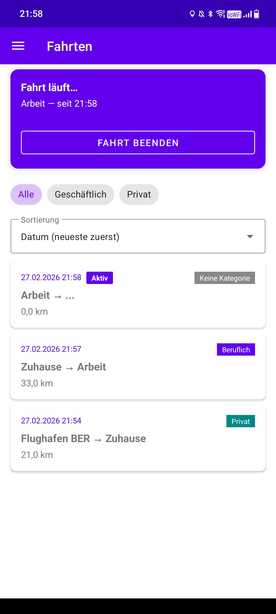
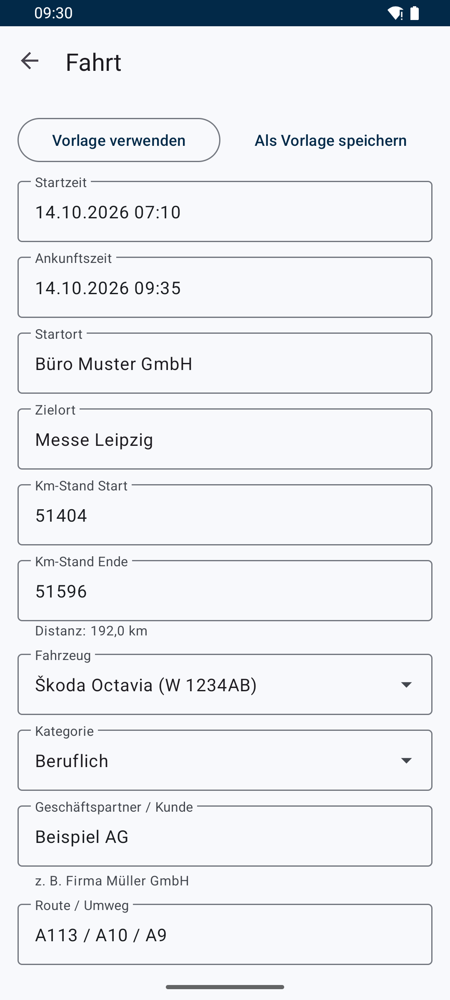
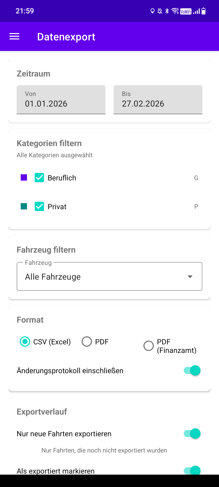

# FOSStenbuch

[](https://github.com/GARSKE-SYSTEMS/FOSStenbuch/actions/workflows/android-ci.yml)

**Free Open Source Software Fahrtenbuch für Android**

FOSStenbuch ist ein quelloffenes, digitales Fahrtenbuch für Android – entwickelt für Privatpersonen, Selbstständige und Unternehmen, die ihre Fahrten einfach, datenschutzfreundlich und ohne Cloud-Zwang dokumentieren möchten.

---

## Features

- **Fahrtenerfassung** – Fahrten mit Start-/Zielort, Kilometerstand, Zweck und Fahrzeug anlegen
- **GPS-Tracking** – Gefahrene Strecke wird während der Fahrt per GPS mitgeschrieben
- **Automatische Fahrterkennung** – Verbindet sich das Handy mit dem Auto-Bluetooth, wird die Fahrt automatisch aufgezeichnet und kann später geprüft und übernommen werden
- **Fahrzeugverwaltung** – Mehrere Fahrzeuge verwalten
- **Fahrzwecke** – Individuelle Fahrzwecke (dienstlich, privat, etc.) definieren
- **Gespeicherte Orte** – Häufig genutzte Orte speichern und wiederverwenden
- **Kilometerstand-Tracking** – Lückenlose Dokumentation der Kilometerstände
- **Statistiken** – Auswertungen und Übersichten über Fahrten und Kilometer
- **Export** – Fahrten als PDF oder CSV exportieren und teilen
- **Backup & Restore** – Lokale Datensicherung und Wiederherstellung
- **Erinnerungen** – Benachrichtigungen zur Fahrtenerfassung
- **Änderungssicher** – Änderungsprotokoll und Hash-Kette je Fahrzeug machen nachträgliche Änderungen erkennbar
- **Vorlagen** – Wiederkehrende Fahrten als Vorlage speichern
- **Material Design** – Moderne Android-Oberfläche mit Material 3 Komponenten
- **Offline-first** – Alle Daten werden lokal auf dem Gerät gespeichert (Room-Datenbank)
- **Kein Tracking, keine Werbung, keine Cloud** – Volle Datenkontrolle

---

## Screenshots

<p float="left">
  
  
  
</p>

---

## Tech Stack

| Bereich              | Technologie                                      |
|----------------------|--------------------------------------------------|
| Sprache              | Kotlin                                           |
| Min SDK              | 26 (Android 8.0)                                 |
| Target SDK           | 35 (Android 15)                                  |
| Architektur          | Bewusst schlicht (KISS): Daten / Logik / UI      |
| Datenbank            | Room (SQLite), ein DAO                           |
| Navigation           | Jetpack Navigation                               |
| Asynchronität        | Kotlin Coroutines + Flow                         |
| UI                   | View Binding + Material 3                        |
| Standort             | Android LocationManager (AOSP, ohne Google-Dienste) |
| Einstellungen        | DataStore Preferences                            |
| Testing              | JUnit 4                                          |
| CI/CD                | GitHub Actions                                   |
| Build System         | Gradle (Kotlin DSL)                              |

---

## Voraussetzungen

- **JDK 17 oder neuer** (getestet bis JDK 25)
- **Android SDK** mit API Level 35
- **Gradle** 9.x (wird über den Gradle Wrapper mitgeliefert)
- Optional: Android Studio (aktuelle Version mit AGP-9-Unterstützung)

---

## Installation & Build

### Projekt klonen

```bash
git clone https://github.com/garske-systems/FOSStenbuch.git
cd FOSStenbuch
```

### Debug-Build erstellen

```bash
./gradlew assembleDebug
```

Die APK liegt anschließend unter `app/build/outputs/apk/debug/app-debug.apk`.
Debug-Builds haben die App-ID `de.garsys.fosstenbuch.debug` und lassen sich neben der Release-Version installieren.

### Tests ausführen

```bash
./gradlew test
```

---

## Projektstruktur

```
app/src/main/java/de/fosstenbuch/
├── App.kt              # Application: Dunkelmodus, Erinnerung neu planen
├── data/               # Room-Entities, ein DAO, Datenbank + Migrationen, Einstellungen (DataStore)
├── logic/              # Geschäftslogik ohne UI
│   ├── Trips.kt        # Fahrten speichern: Validierung, Sperre, Änderungsprotokoll, Hash-Kette
│   ├── Backup.kt       # Backup & Wiederherstellung (JSON)
│   ├── Geo.kt          # Entfernungen, Standort, Adresssuche (OpenStreetMap Nominatim)
│   ├── Mileage.kt      # Kilometer- und Entfernungspauschale
│   ├── Fmt.kt          # Deutsche Zahlen- und Datumsformate
│   └── export/         # CSV, PDF, Finanzamt-PDF
├── tracking/           # GPS-Aufzeichnung, automatische Fahrterkennung (Bluetooth), Erinnerung
└── ui/                 # MainActivity + ein Paket je Bildschirmgruppe, common/ = gemeinsame Helfer
```

---

## Berechtigungen

| Berechtigung                                   | Verwendung                                                        |
|------------------------------------------------|-------------------------------------------------------------------|
| `ACCESS_FINE_LOCATION` / `ACCESS_COARSE_LOCATION` | GPS-Strecke und Ortsvorschläge                                 |
| `ACCESS_BACKGROUND_LOCATION`                   | GPS bei automatisch erkannten Fahrten (App nicht geöffnet)       |
| `FOREGROUND_SERVICE` / `FOREGROUND_SERVICE_LOCATION` | Aufzeichnung als Vordergrunddienst mit Benachrichtigung     |
| `BLUETOOTH_CONNECT` (bzw. `BLUETOOTH` bis Android 11) | Erkennen, wann sich das Auto-Bluetooth verbindet/trennt     |
| `REQUEST_IGNORE_BATTERY_OPTIMIZATIONS`         | Ohne Akku-Optimierung darf die automatische Aufzeichnung starten |
| `POST_NOTIFICATIONS`                           | Erinnerung und Aufzeichnungs-Benachrichtigung                    |
| `RECEIVE_BOOT_COMPLETED`                       | Erinnerung nach Neustart wieder planen                           |
| `INTERNET`                                     | Adresssuche und Ortsnamen über OpenStreetMap                     |

---

## Mitwirken (Contributing)

Beiträge sind herzlich willkommen! So kannst du mitmachen:

1. **Fork** des Repositories erstellen
2. **Feature-Branch** anlegen: `git checkout -b feature/mein-feature`
3. **Änderungen committen**: `git commit -m "feat: Beschreibung der Änderung"`
4. **Branch pushen**: `git push origin feature/mein-feature`
5. **Pull Request** öffnen

### Richtlinien

- Halte es einfach (KISS): so wenig Code wie möglich, keine unnötigen Schichten; Kommentare auf Deutsch
- Schreibe Unit Tests für neue Geschäftslogik
- Verwende [Conventional Commits](https://www.conventionalcommits.org/) für Commit-Messages
- Stelle sicher, dass `./gradlew test` erfolgreich durchläuft

---

## Roadmap

- [ ] F-Droid Veröffentlichung
- [x] Finanzamt-konformer PDF-Export
- [x] Dunkelmodus (Dark Theme)
- [ ] Widget für Schnellerfassung
- [x] Automatische Fahrterkennung (Bluetooth)
- [ ] Multi-Language Support (Englisch)

---

## Lizenz

Dieses Projekt ist unter der **MIT-Lizenz** lizenziert – siehe [LICENSE](LICENSE) für Details.

```
MIT License

Copyright (c) 2026 FOSStenbuch Contributors
```

---

## Maintainer

Dieses Projekt wird betreut und hauptsächlich entwickelt von:

**[Garske Systems](https://garske-systems.de)**

---

## Kontakt

- **Website:** [garske-systems.de](https://garske-systems.de)
- **Issues:** [GitHub Issues](https://github.com/garske-systems/FOSStenbuch/issues)

---

<p align="center">
  Made with ❤️ as Free Open Source Software.
  Dieses Projekt wurde mit KI-unterstützung entwickelt.
</p>
